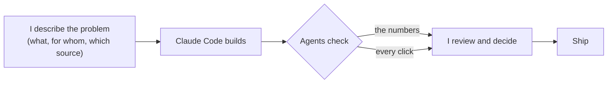
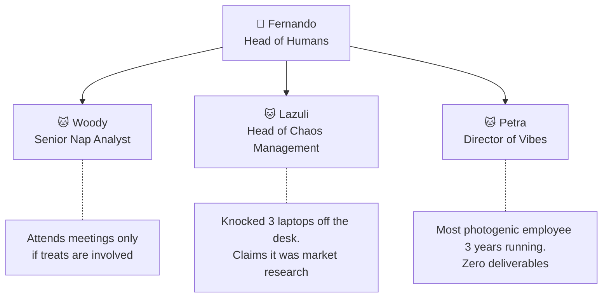

 

&nbsp;
&nbsp;

---

### 👋 Hi, I'm Fernando

I started in **tech recruiting** (200+ hires) and today I work on the **data side of HR**: people dashboards, automations and small HR apps. I like tools that people actually use and numbers that explain themselves, and I build them with **Claude Code** as my pair.

  

> 🎮 A little version of me walks you through each project and tells *what I did and why*.

---

### 🧭 What I work on

- 📊 **People dashboards** that show how each number is counted. [Live demo](https://fernandotrecruiter.github.io/people-analytics-dashboard/)
- 🧩 **HR apps**: job catalog, org chart, employee portal. [Job management](https://fernandotrecruiter.github.io/gerenciamento-de-cargos/)
- ⚙️ **Automation** with Power Automate, Python and Apps Script. [Flowcharts](https://fernandotrecruiter.github.io/#j-fluxos)
- 🤖 **AI as a teammate**: agents that test and check the work before it ships. [How I use it](https://fernandotrecruiter.github.io/#j-agentes)

---

### 🚀 Featured repositories

All demos use a **fictional company** (C. & Paoli corp.): every person and number is generated.

| Repository | What it is |
|---|---|
| [people-analytics-dashboard](https://github.com/FernandoTRecruiter/people-analytics-dashboard) | Executive people dashboard: the math behind every number, the names behind every bar, and a Power BI mode |
| [gerenciamento-de-cargos](https://github.com/FernandoTRecruiter/gerenciamento-de-cargos) | Job management: positions, pay ranges, a career map, a request page and the documentation of each role |
| [organograma-institucional-2](https://github.com/FernandoTRecruiter/organograma-institucional-2) | Interactive org chart with search, open positions and a Power BI mode |
| [claude-graphify-template](https://github.com/FernandoTRecruiter/claude-graphify-template) | A map of what Claude Code knows and uses, with an [interactive simulation](https://fernandotrecruiter.github.io/claude-graphify-template/demo/) |
| [portal-do-colaborador](https://github.com/FernandoTRecruiter/portal-do-colaborador) | One-page HR portal with an admin mode, so HR edits without touching code |
| [Automation.HappyBirthday.Static](https://github.com/FernandoTRecruiter/Automation.HappyBirthday.Static) | Birthday email bot on Google Apps Script, with tests |

<b>This isn't everything.</b> The full story, live demos and the work behind each project are in my <a href="https://fernandotrecruiter.github.io/"><b>portfolio →</b></a>

Side projects: [geometry-reaper](https://github.com/FernandoTRecruiter/geometry-reaper) (a browser game), [financas-pessoais](https://github.com/FernandoTRecruiter/financas-pessoais) (personal finance) and [alcova-flat-executivo](https://github.com/FernandoTRecruiter/alcova-flat-executivo) (a rental site).

---

### 🧰 Stack

            

---

### 🤖 How I work with Claude

---

### 📚 Lessons I learned

- A green test run doesn't replace opening the screen and looking.
- "Accepted" is not "delivered": check that the message actually arrived.
- Personal data never goes into a repository.

🇧🇷 <b>Em português</b>

 

Comecei no **recrutamento tech** (200+ contratações) e hoje trabalho na **parte de dados do RH**: painéis de pessoas, automações e pequenos apps de RH. Gosto de ferramenta que as pessoas usam de verdade e de número que se explica sozinho, e construo tudo com o **Claude Code** como dupla.

Todas as demos usam uma **empresa fictícia** (C. & Paoli corp.): pessoas e números são gerados.

👉 **[Abra o meu portfólio](https://fernandotrecruiter.github.io/)**: um bonequinho meu conta o que eu fiz em cada projeto e por quê.

🐾 <b>Animal Resources Department</b>

 

<code>Fernando Paoli · Brazil · 🦇 always learning</code>

